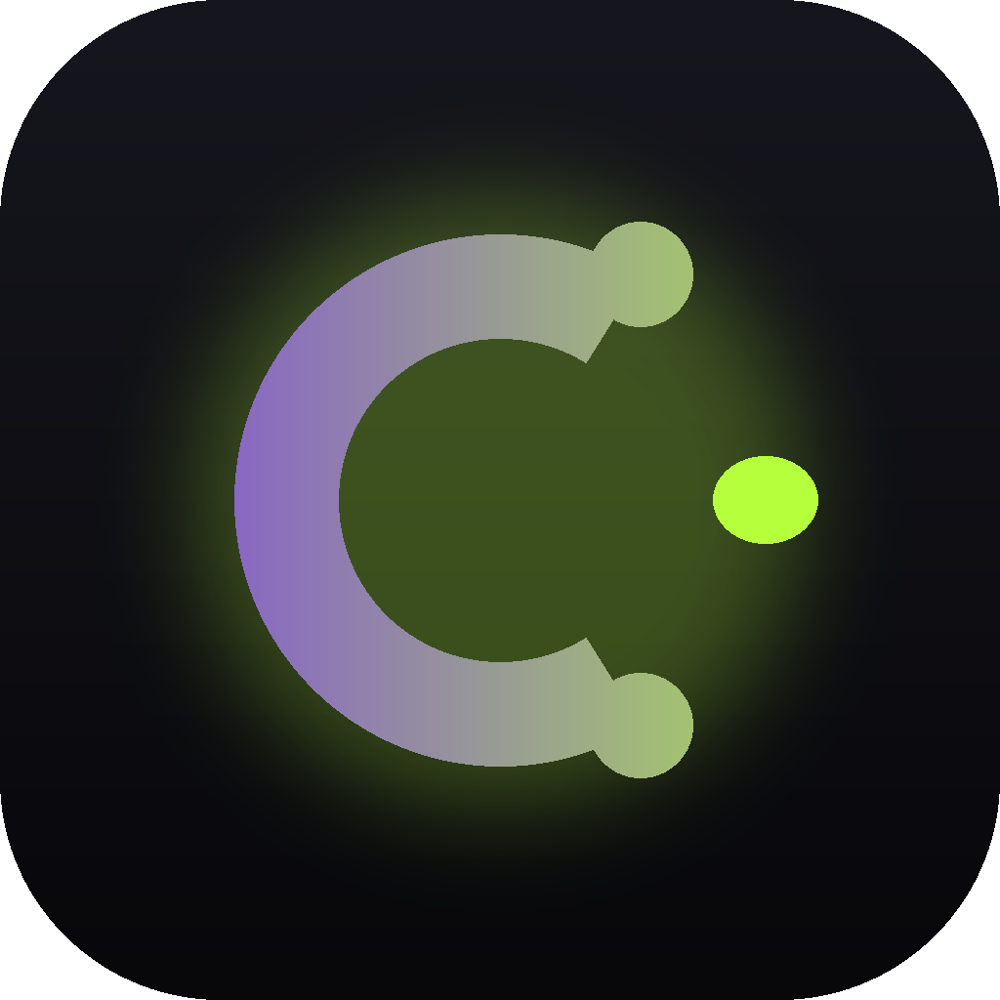

<div align="center">



# Coum Music

**Минималистичный клиент Яндекс.Музыки для Windows.** Неофициальный форк: только музыка — волна, плейлисты, поиск, исполнители. Ничего лишнего.

[](https://t.me/coumfun)
[](../../releases/latest)
[](#установка)

</div>

---

> ⚠️ **Это бета-версия 0.0.1.** Приложение экспериментальное: часть функций может работать некорректно. О находках пишите в [Telegram](https://t.me/coumfun).

## Что умеет

| | |
| --- | --- |
| **Моя волна** | Экран «сейчас играет»: обложка, живой спектр из 10 столбиков (настоящий FFT), управление. Прослушивания и пропуски уходят в rotor, поэтому подбор учится. |
| **Волна по треку** | Три точки на треке → подбор пойдёт от него. Если трек уже играет, он не перезапускается. |
| **Плейлисты** | Свои плейлисты: создание, добавление треков, переименование и удаление по правому клику. |
| **Исполнители** | Клик по имени артиста открывает все его треки с настоящим аватаром. |
| **Альбомы** | Название альбома на экране плеера ведёт на страницу со всеми песнями. |
| **Поиск** | Треки, исполнители, альбомы. Строка поиска всегда в шапке, `Ctrl+K`. |
| **Мне нравится** | Избранное аккаунта, синхронизируется с Яндекс.Музыкой. |
| **12 тем** | От мягко-зелёной до чёрной. Обложки-заглушки собраны из цветов темы и меняются вместе с ней. |
| **Эквалайзер** | 10 полос, ±12 дБ, 8 пресетов, работает поверх потока. |

<div align="center">

| Плейлисты | Мне нравится |
| :---: | :---: |

</div>

## Установка

1. Скачай установщик из [последнего релиза](../../releases/latest).
2. Запусти его (или возьми `coum-music.exe` — портативная версия без установки).
3. Настройки → «Войти через Яндекс».

Требуется Windows 10/11 (64-бит). Больше ничего ставить не нужно: WebView2 установщик подтянет сам.

### ⚠️ Синее окно «Windows защитила ваш компьютер»

При первом запуске Windows покажет предупреждение и надпись **«неизвестный издатель»**. Это нормально и вот почему.

Чтобы такого окна не было, программу нужно подписать цифровым сертификатом. Он стоит **от 100 долларов в год** и выдаётся в основном юридическим лицам. У проекта его нет: приложение бесплатное и делается одним человеком.

**Что делать:** нажми **«Подробнее»** → **«Выполнить в любом случае»**.

Если хочется убедиться, что файл не подменён — в релизе лежит `SHA256SUMS.txt` с контрольными суммами. Проверить можно так:

```cmd
certutil -hashfile "Coum Music_0.0.1_x64-setup.exe" SHA256
```

Сравни результат со строкой в файле — они должны совпасть. А можно просто собрать приложение из исходников ниже.

## Сборка из исходников

```bash
npm install
npm run app:dev      # разработка
npm run app:build    # релиз: exe + установщик
npm run release:pack # разложить по releases/<версия> и собрать zip
```

Нужны Node 18+, Rust (stable, MSVC) и WebView2.

## Как это сделано

Tauri 2 + React 18 + TypeScript. Интерфейс — Material 3 (Pixel UI): тональные поверхности, крупные скругления, Roboto. Тема задаётся четырьмя цветами, остальные роли выводятся через `color-mix()`.

```
src/                фронтенд (React + zustand)
  audio/engine.ts   один <audio> + Web Audio: эквалайзер и анализатор спектра
  store/            player, library, nav, theme, equalizer
src-tauri/          бэкенд (Rust)
  ym/               клиент Яндекс.Музыки, OAuth, разбор ответов
  stream_proxy.rs   локальный прокси аудио (см. ниже)
  commands.rs       IPC-команды
```

### Зачем прокси для звука

Аудио идёт не напрямую с CDN, а через локальную схему `http://coumstream.localhost/<id>`:

- CDN отдаёт **403**, если в запросе есть `Origin`, и не присылает CORS-заголовки — из-за этого Web Audio глушит звук и эквалайзер не работает в принципе;
- Яндекс отдаёт mp3 как `application/octet-stream` — прокси подставляет `audio/mpeg`;
- подписанные ссылки быстро протухают, прокси сам обновляет их;
- подписанный URL больше не виден в JS.

Плюс порционная отдача по 1 МБ: иначе старт трека ждал бы весь файл.

## Важно

Проект использует **неофициальный API** Яндекс.Музыки, тот же, что и мобильный клиент. Он не документирован и может меняться. Это личный клиент для собственного аккаунта: не выкладывайте сборки в магазины приложений.

Lossless (FLAC) не поддерживается, только mp3 до 320 kbps.

## Связь

Всё интересное — в Telegram-канале **[t.me/coumfun](https://t.me/coumfun)**: обновления, сборки, ответы на вопросы.
