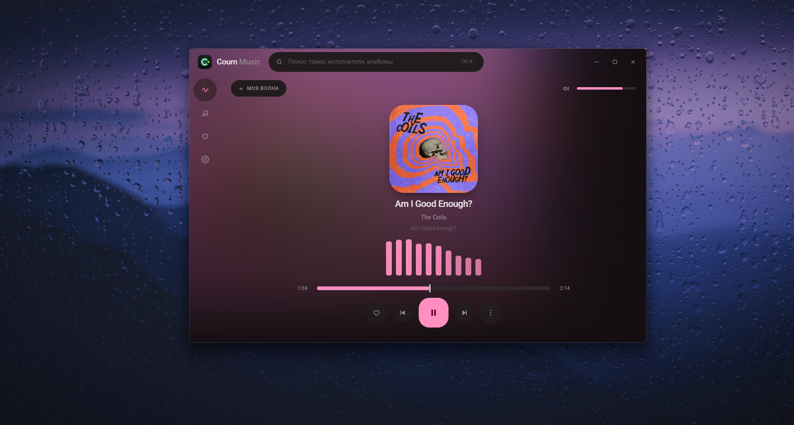
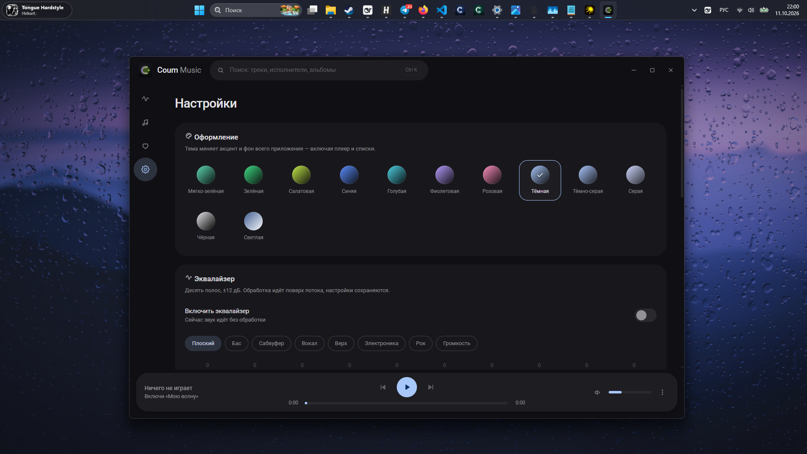
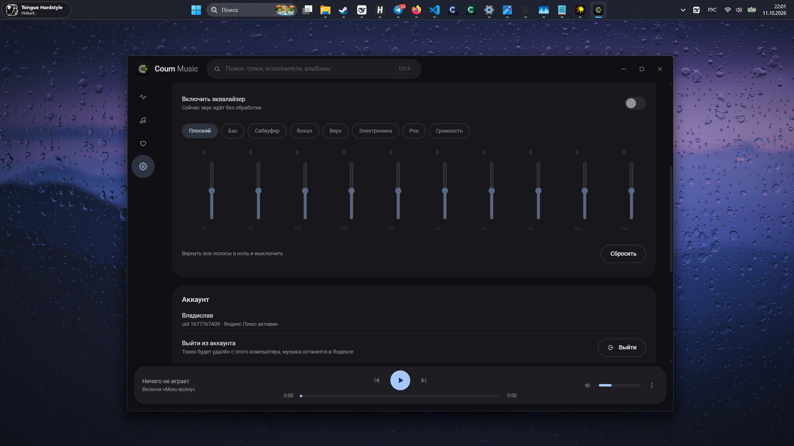
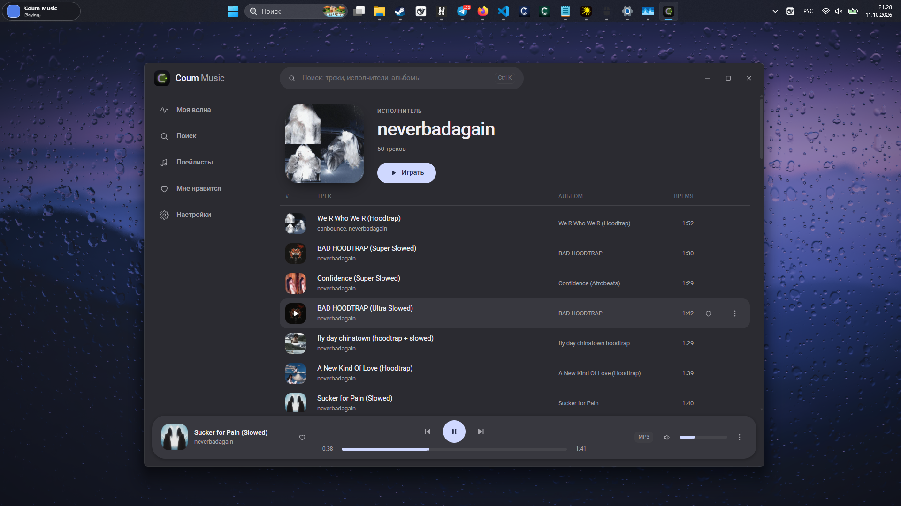

<div align="center">


# Coum Music

**Минималистичный десктоп-клиент Яндекс.Музыки.** Только то, что нужно: Моя волна, плейлисты, поиск и свои исполнители. Ничего лишнего.

[](https://t.me/coumfun)
[](../../releases/latest)
[](#установка)



</div>

---

## Что умеет

| | |
| --- | --- |
| **Моя волна** | Это сразу и экран «сейчас играет»: обложка, живой спектр из 10 столбиков (настоящий FFT, а не анимация) и управление. Пропуски и прослушивания уходят в rotor, поэтому подбор обучается. Плашка сверху показывает, что играет, и по клику открывает очередь. |
| **Волна по треку** | Три точки на треке → «Включить волну по треку»: трек доиграет целиком, дальше Яндекс подберёт похожее. |
| **Исполнители** | Имя исполнителя кликабельно везде — открывается страница со всеми его треками. |
| **Плейлисты** | Отдельная вкладка со всеми своими плейлистами и полным трек-листом. Создавать плейлисты и добавлять в них треки можно прямо в приложении. |
| **Поиск** | Треки, исполнители, альбомы, плейлисты. Строка поиска всегда в шапке, `Ctrl+K`. |
| **Мне нравится** | Избранное аккаунта, лайки синхронизируются с Яндекс.Музыкой. |
| **Эквалайзер** | 10 полос, ±12 дБ, 8 пресетов. Работает поверх потока, настройки сохраняются. |
| **12 тем** | От мяты и салатовой до чёрной и светлой. |

Меню трека: три точки или правый клик → играть, волна по треку, в очередь, в избранное.

Горячие клавиши: `Space` — пауза, `←`/`→` — ±5 секунд, `Ctrl+←`/`Ctrl+→` — переключение трека, `Ctrl+K` — поиск.

<div align="center">

| Настройки и темы | Эквалайзер | Исполнитель |
| :---: | :---: | :---: |
|  |  |  |

</div>

## Установка

1. Скачай установщик из [последнего релиза](../../releases/latest) — `Coum-Music_0.2.0_x64-setup.exe`.
2. Запусти его. Или возьми `coum-music.exe` из того же релиза — портативная версия без установки.
3. Настройки → «Войти через Яндекс». Токен останется только на твоём компьютере, в `%APPDATA%\com.coum.music\session.json`.

### Что нужно для запуска

- **Windows 10 или 11 (64-бит)** — больше ничего. Node, Rust, .NET и прочее не требуются.
- **WebView2** — компонент Microsoft для отображения интерфейса. Установщик сам проверит, есть ли он, и доустановит, если нет (поэтому при установке нужен интернет). На Windows 11 он уже есть, на Windows 10 почти всегда тоже — так что портативная версия обычно тоже заводится сразу.

### Если Windows пишет «Windows защитила ваш компьютер»

Так бывает: сборка **не подписана цифровым сертификатом** (он стоит денег, а проект бесплатный). Windows так встречает любую неподписанную программу.

Нажми **«Подробнее»** → **«Выполнить в любом случае»**. Это не вирус — при желании можно собрать приложение из исходников самому (см. ниже) и убедиться.

## Как это сделано

Tauri 2 + React 18 + TypeScript. Интерфейс — Material 3 (Pixel UI): тональные поверхности вместо свечения, крупные радиусы, Roboto. Тема задаётся четырьмя цветами, остальные роли выводятся через `color-mix()` — новая тема это четыре строки.

```
src/                  фронтенд (React + zustand)
  api/                обёртка над Tauri IPC + типы DTO
  audio/engine.ts     один <audio>, Web Audio: эквалайзер и анализатор спектра
  store/              player, library, nav, theme, equalizer
  components/         шапка, рейл-навигация, плеер, списки, меню, спектр
  views/              волна, поиск, плейлисты, плейлист, исполнитель, избранное, настройки
src-tauri/            бэкенд (Rust)
  ym/                 HTTP-клиент Яндекс.Музыки, OAuth, разбор ответов
  stream_proxy.rs     локальный прокси аудио — см. ниже
  lyrics.rs           тексты песен: Яндекс (HMAC-подпись) + LRCLIB
  commands.rs         IPC-команды
```

### Зачем прокси для звука

Аудио идёт не напрямую с CDN Яндекса, а через локальную схему `http://coumstream.localhost/<id>`:

- CDN отдаёт **403**, если в запросе есть заголовок `Origin`, и не присылает `Access-Control-Allow-Origin` — из-за этого Web Audio считает поток «чужим» и **глушит звук**, то есть эквалайзер и визуализатор на прямом URL не работают в принципе;
- Яндекс отдаёт mp3 как `application/octet-stream`, и Chromium либо отказывается его играть, либо считает длительность по объёму (получались «треки» на 28 часов) — прокси отдаёт `audio/mpeg`;
- подписанные ссылки живут недолго — прокси сам перезапрашивает их при 403/410;
- побочный плюс: подписанный URL больше не виден в JS.

Плюс порционная отдача по 1 МБ: иначе обработчик схемы Tauri ждал бы весь файл и переключение треков было бы медленным.

## Сборка из исходников

```bash
npm install
npm run app:dev        # разработка
npm run app:build      # релиз: exe + установщик
npm run release:pack   # разложить по releases/<версия>/ и собрать zip
```

Нужны Node 18+, Rust (stable, MSVC toolchain) и WebView2.

## Важно

Проект использует **неофициальный, приватный API** Яндекс.Музыки — тот же, что и мобильный клиент. Он не документирован, может меняться без предупреждения, а его использование нарушает пользовательское соглашение сервиса. Это личный клиент для собственного аккаунта: не выкладывай сборки в магазины приложений и не подключай чужие аккаунты.

Lossless (FLAC) не поддерживается — только mp3 до 320 kbps.

## Связь

Всё интересное — в Telegram-канале **[t.me/coumfun](https://t.me/coumfun)**: обновления, сборки, ответы на вопросы.
